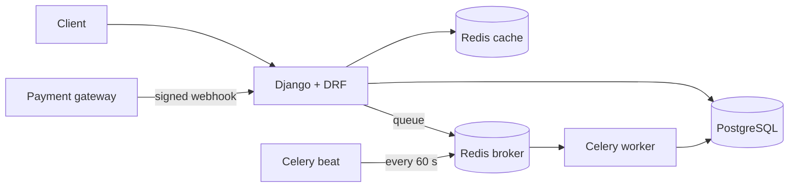

# Event Ticketing API

[](https://github.com/anasyaghi9/ticketing/actions/workflows/ci.yml)

A backend for selling tickets to events, built around one hard problem: **many people trying to book the same seat at the same moment, with no double booking.**

**Stack:** Django 5.2, Django REST Framework, PostgreSQL 16, Redis 7, Celery, Docker Compose.
**Live demo:** coming soon (deployment in progress).
**API docs:** `/api/docs/` (Swagger UI) when running locally.

## The core problem

A seat can be sold once. Two requests that both ask "is it free?" before either one writes will both get "yes". This project prevents that with two independent layers:

1. **Row lock in the application.** `book_seat()` runs inside `transaction.atomic` and locks the seat row with `select_for_update()`. Concurrent requests for the same seat queue up, and each one sees the real state when its turn comes. Losers get a clean `409 Conflict`.
2. **Constraint in the database.** A PostgreSQL partial unique index allows at most one booking per seat whose status is `pending` or `confirmed`. Even if the application code had a bug, the database refuses the second booking.

```python
models.UniqueConstraint(
    fields=["seat"],
    condition=Q(status__in=["pending", "confirmed"]),
    name="unique_active_booking_per_seat",
)
```

### Proof under load

20 seats, 100 concurrent simulated users, 30 seconds (Locust):

| Check | Result |
|---|---|
| Requests | 563 (108 were booking attempts) |
| Unexpected failures (5xx, 429) | 0 |
| Active bookings on the event | exactly 20, one per seat |
| Seats with more than one active booking | 0 |

A 20-thread test with and without the lock shows what each layer does. Without the lock, 6 of 20 requests reached the database constraint and failed with a raw `IntegrityError`. With the lock, all 19 losing requests were rejected cleanly and none hit the constraint. The data stayed correct in both cases; the lock is what makes the failure clean.

> **Note on performance numbers:** the run above used Django's development server, with the database, Redis, workers and Locust all sharing one laptop. Correctness was verified; the latency figures (median about 2.3 s) are a baseline, not a target. The same test will be repeated against Gunicorn behind Nginx on a VPS, and both results will be listed here.

## Architecture



Nginx and Gunicorn in front of the API are part of the deployment step (planned).

## Booking flow

1. A user books a seat and gets a **10-minute hold** (`pending` booking).
2. The user starts a payment for that booking.
3. The payment gateway calls the **webhook**. The booking becomes `confirmed` and a confirmation email is queued.
4. If the hold expires, a Celery beat task marks it `expired` every minute. A booking path also frees expired holds lazily, so a seat never stays blocked by a dead hold.

## Design decisions

- **The booking is the source of truth.** A seat has no status column. It is available when it has no active booking, so there are never two fields that can disagree.
- **Business logic lives in `services.py`**, not in the views. Services are plain functions, easy to test, and Celery tasks are thin wrappers around them.
- **Webhook safety.** The signature is an HMAC-SHA256 of the raw request body, compared in constant time. Every webhook carries an `event_id` stored under a unique constraint, so the same webhook delivered twice has no second effect. The payment row is locked while it is processed.
- **Side effects run after commit.** Emails and cache invalidation use `transaction.on_commit`, so a rolled-back transaction never sends an email or leaves a stale cache.
- **Late payments are not lost.** If a payment succeeds after the booking already expired, the payment is marked `refund_required` instead of being silently dropped.
- **Cache only what is safe.** The event list is cached in Redis for 60 seconds and invalidated on any change. Seat availability is never cached, because a stale "available" is worse than a slow page.
- **Rate limits.** Login: 10 per minute per IP. Booking: 30 per minute per user.
- **No N+1 queries.** Event detail computes availability for all seats in a single annotated query. Tests fail if the number of queries grows with the data.
- **Ownership returns 404.** Another user's booking looks like a missing booking, so the API does not confirm that it exists.

## API overview

| Method | Path | Notes |
|---|---|---|
| POST | `/api/auth/register/` | Creates an attendee |
| POST | `/api/auth/login/` | JWT access and refresh tokens |
| POST | `/api/auth/refresh/` | New access token |
| GET | `/api/auth/me/` | Current user |
| GET | `/api/events/` | Public, cached |
| POST | `/api/events/` | Organizers only |
| GET / PATCH / DELETE | `/api/events/<id>/` | Detail with live seat availability; edits by the owner only |
| POST | `/api/events/<id>/seats/` | Bulk seat creation, for example rows A to J, 20 per row |
| POST | `/api/events/seats/<id>/book/` | 201, 401, 404 or 409 |
| POST | `/api/events/bookings/<id>/cancel/` | Owner only |
| GET | `/api/events/my-bookings/` | Your bookings |
| POST | `/api/payments/` | Start a payment for a pending booking |
| POST | `/api/payments/webhook/` | Signed, idempotent gateway callback |

Full interactive documentation: `/api/docs/`.

## Run it locally

```bash
cp .env.example .env
docker compose up -d --build
docker compose exec web python manage.py migrate
docker compose exec web python manage.py createsuperuser
```

The API is at `http://localhost:8000`, Swagger at `http://localhost:8000/api/docs/`. In development, "sent" emails are printed in the worker log (`docker compose logs worker`).

Organizer accounts are created from the admin panel by setting the user's role. Public registration always creates attendees.

## Tests

```bash
docker compose exec web pytest
```

The suite covers the booking services, permissions and status codes, the webhook (signature, duplicates, late success), the cache and its invalidation, rate limiting, query counts, and a 20-thread concurrency test that requires exactly one winner. GitHub Actions runs it against a real PostgreSQL on every push.

## Load test

```bash
docker compose exec web python manage.py load_prepare --users 200 --seats 20
docker compose --profile load run --rm locust
```

## Index measurement

`EXPLAIN ANALYZE` on the query the expiry task runs, over 100,000 bookings (`python manage.py seed_perf`, then `perf/explain_expire.sql`):

| | Scan type | Execution time |
|---|---|---|
| With index on `(status, hold_expires_at)` | TBD | TBD |
| Without the index | TBD | TBD |

## Status and roadmap

Done: models and constraints, concurrency-safe booking, JWT auth and roles, organizer endpoints, cancel, holds with Celery expiry, payments with webhook, cache and rate limiting, tests, CI, API docs.

Next: production settings, Gunicorn and Nginx, HTTPS and a domain, deployment to a VPS with CI/CD, structured logging. Later: organizer dashboard, internal wallet with a ledger.
