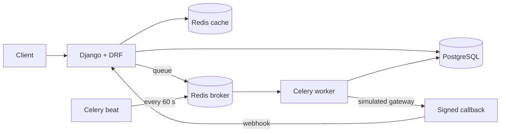

# Event Ticketing API

[](https://github.com/anasyaghi9/ticketing/actions/workflows/ci.yml)

A backend for selling tickets to events, built around one hard problem: **many people trying to book the same seat at the same moment, with no double booking.**

**Stack:** Django 5.2, Django REST Framework, PostgreSQL 16, Redis 7, Celery, Docker Compose, Gunicorn.
**Live demo:** coming soon (deployment in progress).
**API docs:** `/api/docs/` (Swagger UI) when running locally.

## The core problem

A seat can be sold once. Two requests that both ask "is it free?" before either one writes will both get "yes". This project prevents that with two independent layers:

1. **Row lock in the application.** `book_seat()` runs inside `transaction.atomic` and locks the seat row with `select_for_update()`. Concurrent requests for the same seat queue up, and each one sees the real state when its turn comes. Losers get a clean `409 Conflict`.
2. **Constraint in the database.** A PostgreSQL partial unique index allows at most one booking per seat whose status is `pending` or `confirmed`. Even if the application code had a bug, the database refuses the second booking.

```python
models.UniqueConstraint(
    fields=["seat"],
    condition=Q(status__in=["pending", "confirmed"]),
    name="unique_active_booking_per_seat",
)
```

### Proof under load

20 seats, 100 concurrent simulated users, 30 seconds (Locust):

| Check | Result |
|---|---|
| Requests | 563 (108 were booking attempts) |
| Unexpected failures (5xx, 429) | 0 |
| Active bookings on the event | exactly 20, one per seat |
| Seats with more than one active booking | 0 |

A 20-thread test with and without the lock shows what each layer does. Without the lock, 6 of 20 requests reached the database constraint and failed with a raw `IntegrityError`. With the lock, all 19 losing requests were rejected cleanly and none hit the constraint. The data stayed correct in both cases; the lock is what makes the failure clean.

> **Note on performance numbers:** the run above used Django's development server, with the database, Redis, workers and Locust all sharing one laptop. Correctness was verified; the latency figures (median about 2.3 s) are a baseline, not a target. The same test will be repeated against Gunicorn behind Nginx on a VPS, and both results will be listed here.

## Architecture



Nginx in front of the API is part of the deployment step (planned).

## Booking flow

1. A user books a seat and gets a **10-minute hold** (`pending` booking).
2. The user starts a payment for that booking, then submits a card.
3. A simulated gateway (`FakeGateway`, swappable through the `PAYMENT_GATEWAY` setting) answers the payment request immediately with `202` and calls the signed webhook asynchronously through Celery. The test card `4242424242424242` succeeds; any other card is declined.
4. On success the booking becomes `confirmed` and a confirmation email is queued. A declined payment leaves the hold running, so the user can retry until it expires.
5. If the hold expires, a Celery beat task marks it `expired` every minute. The booking path also frees expired holds lazily, so a seat is never blocked by a dead hold.

## Design decisions

- **The booking is the source of truth.** A seat has no status column. It is available when it has no active booking, so there are never two fields that can disagree.
- **Booking rules, enforced under the lock.** A seat can't be booked once its event has started, and one user can hold at most 4 seats per event. The user row is locked first, so even 8 parallel requests from one person are checked one at a time (covered by a test).
- **Business logic lives in `services.py`**, not in the views. Services are plain functions, easy to test, and Celery tasks are thin wrappers around them.
- **Payment gateway behind an interface.** `PaymentGateway` is a small abstract class, so a real provider can replace the simulator by changing one setting.
- **Webhook safety.** The signature is an HMAC-SHA256 of the raw request body, compared in constant time. Every webhook carries an `event_id` stored under a unique constraint, so the same webhook delivered twice has no second effect, including Celery retries. The payment row is locked while it is processed.
- **Side effects run after commit.** Emails and cache invalidation use `transaction.on_commit`, so a rolled-back transaction never sends an email or leaves a stale cache.
- **Late payments are not lost.** If a payment succeeds after the booking already expired, the payment is marked `refund_required` instead of being silently dropped.
- **Paginated, cached event list.** Upcoming events only, 20 per page. Each page is cached in Redis under a versioned key, so one version bump invalidates every page at once, and pagination links are built per request instead of being cached. Seat availability is never cached, because a stale "available" is worse than a slow page.
- **Rate limits.** Login: 10 per minute per IP. Booking: 30 per minute per user.
- **No N+1 queries.** Event detail computes availability for all seats in a single annotated query. Tests fail if the number of queries grows with the data.
- **Ownership returns 404.** Another user's booking or payment looks like a missing one, so the API does not confirm that it exists.

## API overview

| Method | Path | Notes |
|---|---|---|
| POST | `/api/auth/register/` | Creates an attendee |
| POST | `/api/auth/login/` | JWT access and refresh tokens |
| POST | `/api/auth/refresh/` | New access token |
| GET | `/api/auth/me/` | Current user |
| GET | `/api/events/` | Public, cached, paginated, upcoming events only |
| POST | `/api/events/` | Organizers only |
| GET / PATCH / DELETE | `/api/events/<id>/` | Detail with live seat availability; edits by the owner only |
| POST | `/api/events/<id>/seats/` | Bulk seat creation, for example rows A to J, 20 per row |
| POST | `/api/events/seats/<id>/book/` | 201, 401, 404 or 409 |
| POST | `/api/events/bookings/<id>/cancel/` | Owner only |
| GET | `/api/events/my-bookings/` | Your bookings |
| POST | `/api/payments/` | Start a payment for a pending booking |
| POST | `/api/payments/<reference>/pay/` | Submit a card to the simulated gateway (202) |
| POST | `/api/payments/webhook/` | Signed, idempotent gateway callback |
| GET | `/api/health/` | Database check for monitors |

Full interactive documentation: `/api/docs/`.

## Run it locally

```bash
cp .env.example .env
docker compose up -d --build
docker compose exec web python manage.py migrate
docker compose exec web python manage.py createsuperuser
```

The API is at `http://localhost:8000`, Swagger at `http://localhost:8000/api/docs/`. In development, "sent" emails are printed in the worker log (`docker compose logs worker`).

Organizer accounts are created from the admin panel by setting the user's role. Public registration always creates attendees.

## Production stack

`docker-compose.prod.yml` runs Gunicorn with WhiteNoise for static files, restarts services automatically, binds the app to localhost only, and publishes no database or Redis ports. Secrets come from `.env.prod` (see `.env.prod.example`); the app refuses to start with `DEBUG` off and a `SECRET_KEY` shorter than 32 characters.

```bash
cp .env.prod.example .env.prod   # then fill in real secrets
docker compose -p ticketing_prod -f docker-compose.prod.yml up -d --build
```

## Tests

```bash
docker compose exec web pytest
```

59 tests cover the booking services and rules, permissions and status codes, the webhook (signature, duplicates, late success), the payment gateway, the cache and its invalidation, pagination, rate limiting, query counts, and two concurrency tests: 20 users racing for one seat, and 8 parallel requests from one user against the per-user limit. GitHub Actions runs the suite against a real PostgreSQL on every push.

## Load test

```bash
docker compose exec web python manage.py load_prepare --users 200 --seats 20
docker compose --profile load run --rm locust
```

## Index measurement

`EXPLAIN (ANALYZE, BUFFERS)` on the query the expiry task runs, over 100,029 bookings (about 0.3% of them stale `pending` holds), PostgreSQL 16 in Docker on a laptop under WSL2. Reproduce with `python manage.py seed_perf` and `perf/explain_expire.sql`.

| | Plan | Execution time | Buffers read |
|---|---|---|---|
| With index on `(status, hold_expires_at)` | Bitmap Index Scan | 0.66 ms | 267 |
| Without the index | Seq Scan | 8.22 ms | 936 |

About 12 times faster and 3.5 times fewer pages read. The gap grows with table size, because a sequential scan reads every row while the index reads only the matching ones.

## Known limitations

- Payments use a simulator; no real payment provider is integrated.
- A payment that succeeds after its booking expired is marked `refund_required`, but refunds are not processed yet.
- Latency figures come from the development server; production numbers will be added after deployment.
- Not built yet: organizer dashboard and reports, cancellation emails, an internal wallet.

## Roadmap

Next: deploy to a VPS with Nginx, HTTPS and a domain, automatic deployment from CI, structured logging, database backups. Later: organizer dashboard, wallet with a ledger.
